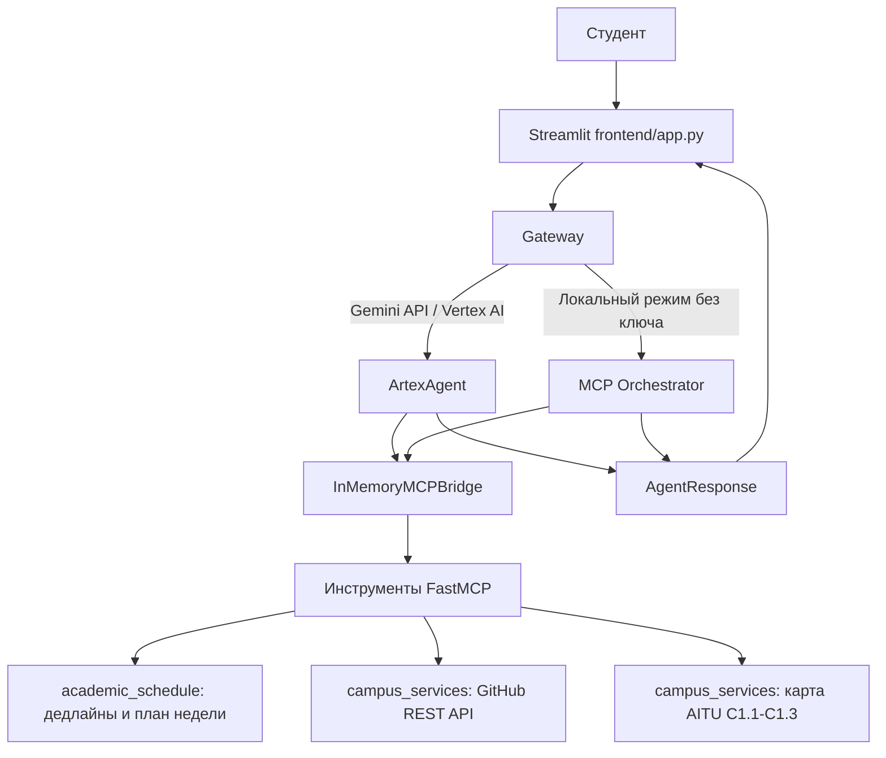

# Архитектура Artex AI

## Схема работы

## Модули

- `frontend/app.py` — чат-интерфейс, переключение светлой/тёмной темы, быстрые действия и панель дедлайнов.
- `frontend/gateway.py` — шлюз между UI, локальным агентом `ArtexAgent`, оркестратором MCP и облачным Vertex AI.
- `frontend/ui_components.py` — стили тем и карточки задач.
- `agent/` — цикл рассуждений Gemini с вызовом инструментов (`artex_agent.py`), мост инструментов (`mcp_bridge.py`) и модели данных (`models.py`).
- `core/deadline_logic.py` — расчёт срочности, фильтрация задач, парсинг силлабуса и планировщик недели.
- `mcp_servers/` — серверы инструментов `academic_schedule.py` и `campus_services.py`.
- `deployment/deploy.py` — скрипт деплоя в Vertex AI Agent Engine.
